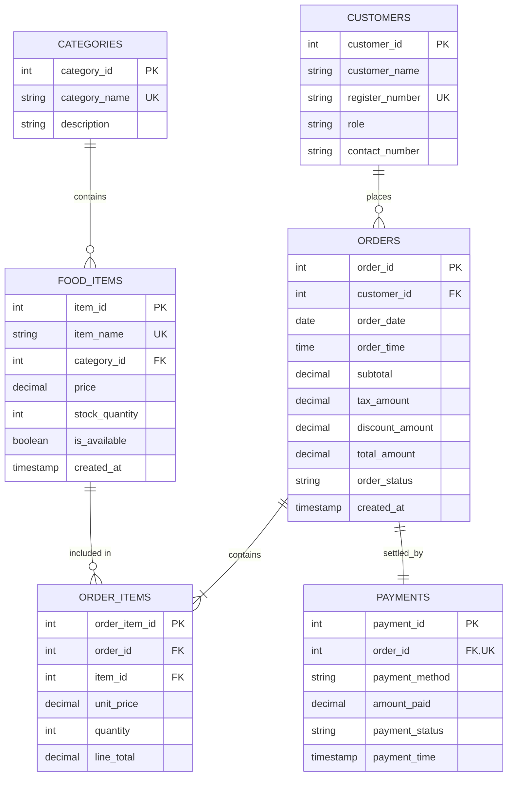

# Database Design and Normalization Documentation
## College Canteen Ordering and Sales Analysis System
**Course:** 25ITT31 - Database Management Systems  
**Institution:** Velalar College of Engineering and Technology, Erode - 12  
**Scenario:** 3 (Register No.: 3, 33, 63, 93)  

---

## 1. Entity-Relationship (ER) Model

The database model captures all operational relationships within the campus canteen:

---

## 2. Relational Schema Specification

1. **`categories`** (`category_id` [PK], `category_name`, `description`)
2. **`food_items`** (`item_id` [PK], `item_name`, `category_id` [FK &rarr; categories.category_id], `price`, `stock_quantity`, `is_available`, `created_at`)
3. **`customers`** (`customer_id` [PK], `customer_name`, `register_number`, `role`, `contact_number`)
4. **`orders`** (`order_id` [PK], `customer_id` [FK &rarr; customers.customer_id], `order_date`, `order_time`, `subtotal`, `tax_amount`, `discount_amount`, `total_amount`, `order_status`, `created_at`)
5. **`order_items`** (`order_item_id` [PK], `order_id` [FK &rarr; orders.order_id], `item_id` [FK &rarr; food_items.item_id], `unit_price`, `quantity`, `line_total`)
6. **`payments`** (`payment_id` [PK], `order_id` [FK &rarr; orders.order_id, UK], `payment_method`, `amount_paid`, `payment_status`, `payment_time`)

---

## 3. Database Normalization Proof (1NF to 3NF/BCNF)

### 3.1 First Normal Form (1NF)
- **Criteria:** Each column contains atomic values, no repeating groups or multivalued attributes exist, and each record is identified by a primary key.
- **Implementation:** In legacy manual records, multiple dishes were recorded in a single cell (e.g. "Dosa x 2, Coffee x 1"). We decomposed order line items into an independent `order_items` table where every row represents exactly one item in an order.

### 3.2 Second Normal Form (2NF)
- **Criteria:** Meets 1NF, and all non-key attributes are fully functionally dependent on the entire primary key (no partial dependencies).
- **Implementation:** In the `order_items` table, `order_item_id` is the primary key. If composite key `(order_id, item_id)` were used with `item_name` stored inline, `item_name` would depend only on `item_id`, violating 2NF. By storing `item_name` in `food_items` and only referencing `item_id`, all partial dependencies are eliminated.

### 3.3 Third Normal Form (3NF)
- **Criteria:** Meets 2NF, and no non-key attribute is transitively dependent on the primary key ($X \rightarrow Y$ and $Y \rightarrow Z$).
- **Implementation:**
  - Customer role and register number are stored in `customers`, not duplicated in `orders`.
  - Category details (`category_name`, `description`) are maintained in `categories` rather than repeating in `food_items`.
  - Hence, no transitive dependencies exist.

### 3.4 Boyce-Codd Normal Form (BCNF)
- **Criteria:** For every functional dependency $X \rightarrow Y$, the determinant $X$ is a superkey.
- **Implementation:** All functional dependencies have candidate keys as determinants:
  - `item_id` &rarr; `item_name`, `category_id`, `price`, `stock_quantity`
  - `order_id` &rarr; `customer_id`, `order_date`, `total_amount`
  - `category_id` &rarr; `category_name`, `description`
  Thus, all relations satisfy BCNF.

---

## 4. Integrity Constraints & Business Rules
1. **Domain Integrity:** Unit prices, quantities, and totals are constrained by `CHECK` expressions to prevent negative entries (`price >= 0`, `quantity > 0`).
2. **Referential Integrity:** Enforced foreign key cascades (`ON DELETE CASCADE` for order items when an order is removed) and restricted deletes (`ON DELETE RESTRICT` for categories containing active food items).
3. **Transaction Safety:** ACID properties maintained across order creation and stock decrements.
