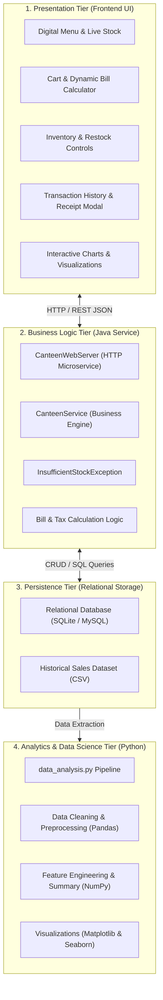
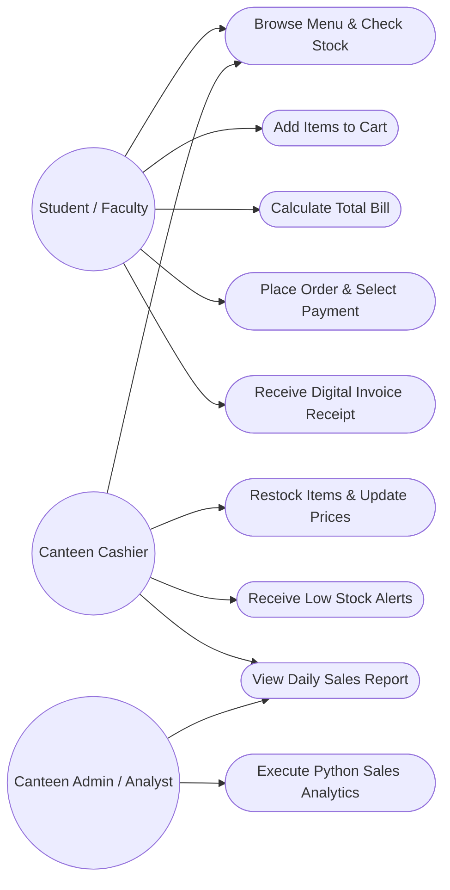
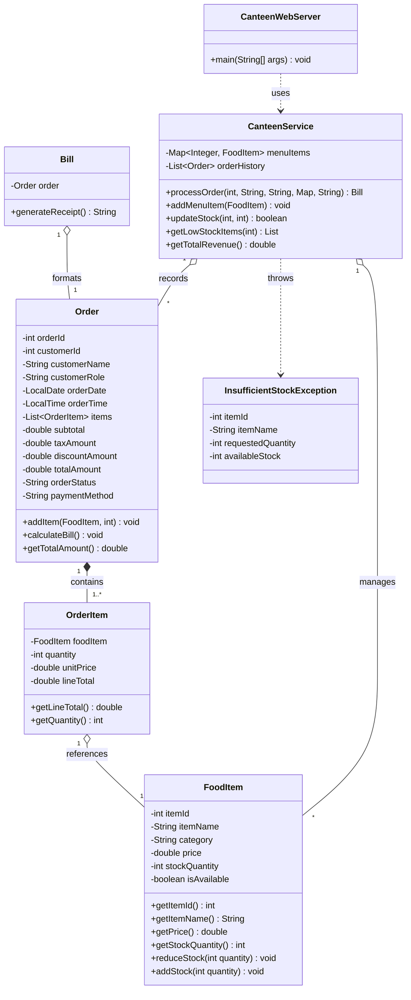
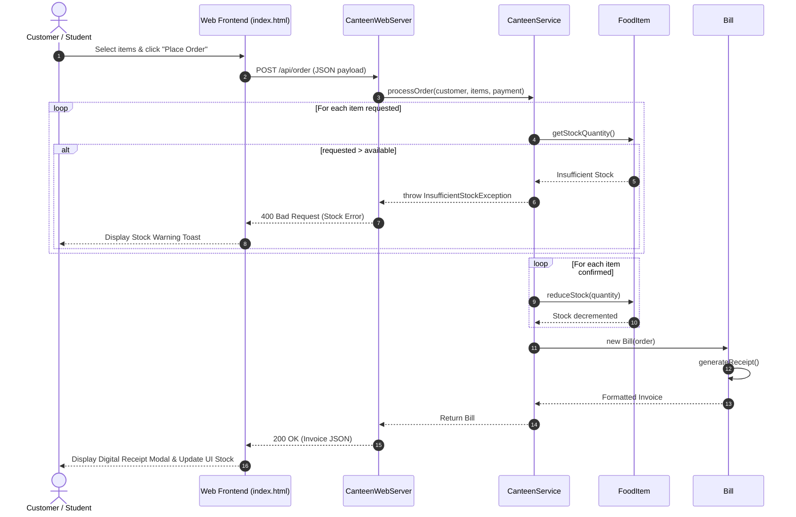

# System Design and Architecture Documentation
## College Canteen Ordering and Sales Analysis System
**Course:** 25ITT33 - Software Engineering  
**Institution:** Velalar College of Engineering and Technology, Erode - 12  
**Scenario:** 3 (Register No.: 3, 33, 63, 93)  

---

## 1. Overall System Architecture

The system implements a modular 4-Tier Architecture separating presentation, business logic, persistence, and analytics:

---

## 2. Use Case Diagram

---

## 3. Class Diagram (Java OOP Structure)

---

## 4. Sequence Diagram (Order Processing & Stock Check)

